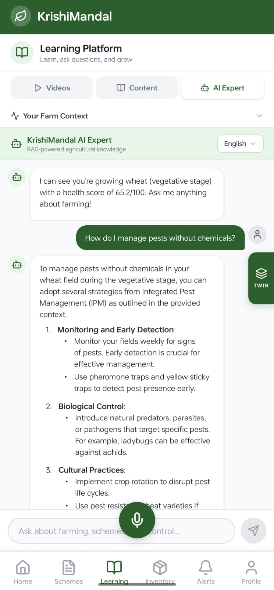
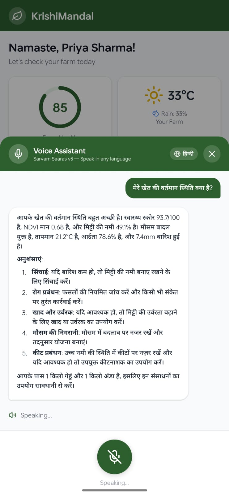
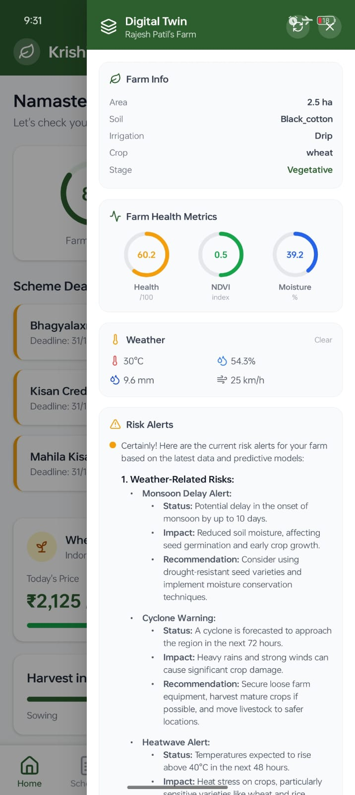
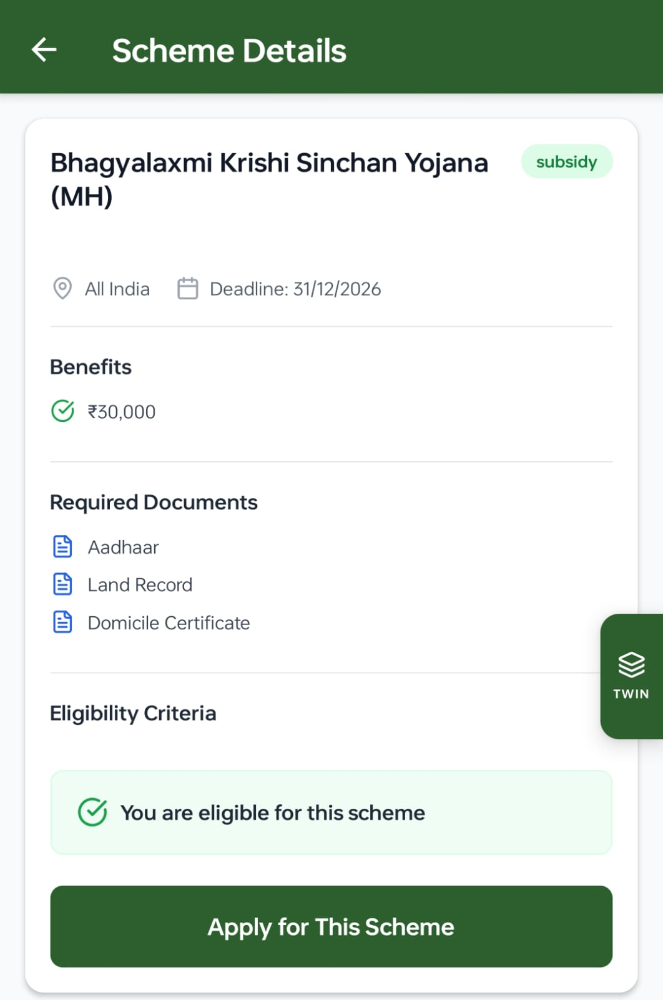
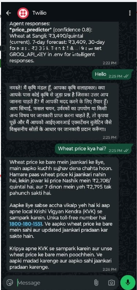
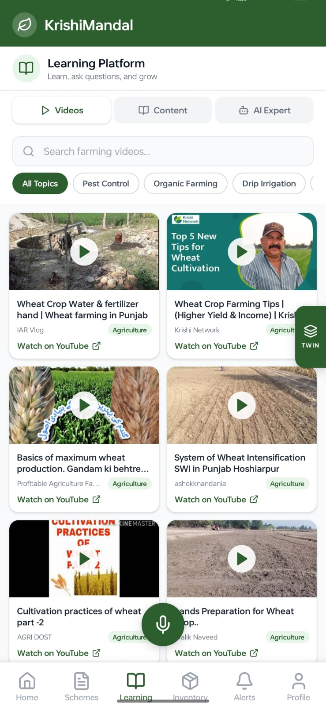
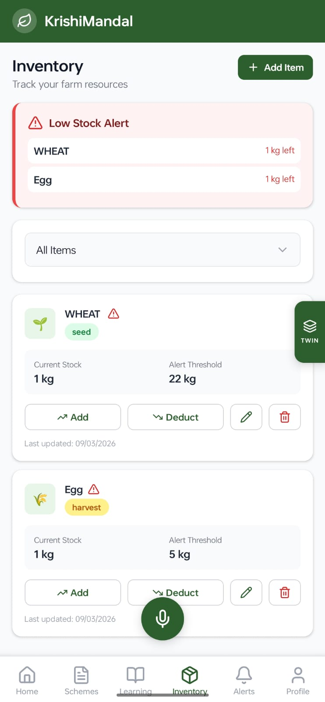
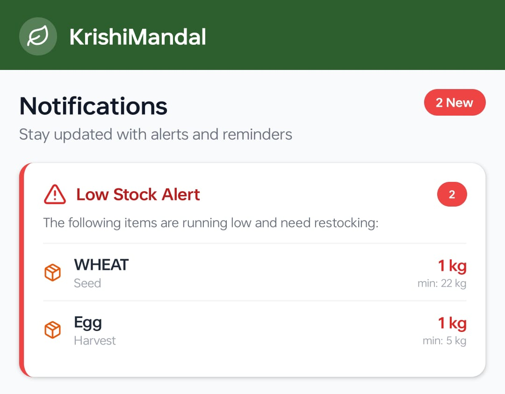

<h1 align="center">KrishiMandal</h1>

<p align="center">
  <strong>AI-Powered Agricultural Intelligence Platform for Indian Farmers</strong>
</p>

<p align="center">
  
  
  
  
  
</p>

---

KrishiMandal is an end-to-end agricultural intelligence platform that empowers Indian smallholder farmers with AI-driven insights, multilingual voice interaction, real-time farm monitoring, and WhatsApp notifications — accessible via web, mobile, and messaging.

---

## Features

### Multi-Agent AI Orchestrator

A supervisor agent intelligently routes farmer queries to **6 specialized sub-agents** that collaborate to deliver comprehensive answers:

| Agent | Capabilities |
|-------|-------------|
| **Digital Twin** | Farm state monitoring, NDVI/soil moisture, weather forecasts, yield prediction, what-if simulation |
| **Crop Management** | Crop health scoring, pest & disease detection, fertilizer and irrigation recommendations |
| **Price Predictor** | Mandi price forecasting (7/30 day), sell-or-store decisions, best market identification |
| **Scheme & Credit** | Government scheme matching (PM-KISAN, PMFBY, KCC), eligibility scoring, credit assessment |
| **Supply Chain** | Harvest logistics, collection route optimization, quality grading, transport cost estimation |
| **Learning Platform** | RAG-powered Q&A, farming techniques, educational videos, community knowledge |


>
> 

---

### Voice Assistant (22 Indian Languages)

Voice-first interface powered by **Sarvam AI Saaras v3** (STT) and **Bulbul v3** (TTS). Farmers speak in their language — Hindi, Tamil, Bengali, Marathi, Telugu, Kannada, Odia, and 15 more — and receive spoken responses.

- Intent-based routing: farming techniques go to RAG, farm-specific queries get digital twin context
- Non-blocking TTS for instant UI feedback
- Language selector with native script labels


>
> 

---

### Digital Twin Sidebar

A live virtual replica of the farmer's field with real-time metrics:

- **Health Gauges** — NDVI vegetation index, soil moisture, overall health score
- **Weather** — Current conditions + 7-day forecast with rain, temperature, humidity
- **Harvest Countdown** — Days to harvest, yield estimate with confidence score
- **Risk Alerts** — Pest threats, weather warnings, health decline notifications
- **What-If Simulator** — Model drought, pest outbreak, early harvest, or alternative crop scenarios with AI-generated impact analysis


>
> 

---

### Government Schemes & Applications

- Browse and search government agricultural schemes (Subsidy, Insurance, Irrigation, Credit)
- **AI-powered eligibility matching** with compatibility scores
- Full application workflow with document upload
- **OCR document scanning** — Upload Aadhaar, bank passbook, land records, domicile certificates and auto-extract fields (name, account number, address, etc.)


>
> 

---

### Inventory Management

- Track farm inputs: seeds, fertilizers, pesticides, equipment
- Quick stock adjustments with usage history
- **Automated low-stock alerts** via in-app notifications and WhatsApp
- Categorized view with search and filter


>
> 

---

### WhatsApp Notifications (Twilio)

Real-time alerts and daily digest delivered straight to WhatsApp:

- **Real-time alerts** — Low stock, crop health decline, pest detection, price spikes, scheme deadlines
- **Daily morning digest** (6:30 AM IST) — Unread notifications, low stock items, farm status summary
- **AI-triggered sends** — Tell the chatbot "send me this on WhatsApp" and it does
- **Opt-in toggle** in profile settings with Twilio sandbox support


> 

---

### Learning Platform with RAG

- **Retrieval-Augmented Generation** — Knowledge documents stored in **Amazon S3**, embedded with **Bedrock Titan**, vector-searched via in-memory cosine similarity, and answered by **Bedrock Nova Pro**
- Falls back to Pinecone + Gemini embeddings + Groq LLM on the EC2 backend if Lambda is unavailable
- Topic-based learning: Pest Control, Organic Farming, Drip Irrigation, Soil Health, Water Management
- YouTube video search integration
- Supports queries in all 22 Indian languages


>
> 

---

### Dashboard & Notifications

- Quick overview: active applications, inventory alerts, crop health, scheme recommendations
- Real-time notification center with unread counts
- Event-driven architecture — agents automatically generate alerts when they detect issues


>
> 
> 


---

## Tech Stack

| Layer | Technology |
|-------|-----------|
| **Web Frontend** | React 18, TypeScript, Vite, Tailwind CSS |
| **Mobile App** | React Native, Expo |
| **Backend (EC2)** | FastAPI, Python 3.12, SQLite |
| **Serverless** | 15 AWS Lambda Functions, API Gateway, EventBridge |
| **Database** | Amazon DynamoDB (serverless), SQLite (EC2) |
| **AI/LLM** | Amazon Bedrock Nova Pro (primary), Groq Llama 3.3 70B (EC2 fallback) |
| **RAG Pipeline** | S3 knowledge base → Bedrock Titan embeddings → in-memory cosine vector search |
| **RAG Fallback** | Pinecone + Gemini embeddings + Groq (EC2 fallback) |
| **Voice** | Sarvam AI — Saaras v3 (STT), Bulbul v3 (TTS) |
| **Messaging** | Twilio WhatsApp Business API |
| **Storage** | Amazon S3 (knowledge base, documents) |
| **CDN/Proxy** | Amazon CloudFront |
| **Hosting** | AWS Amplify (website), EC2 c7i-flex.large (backend) |

---

## AWS Services

### Amazon Amplify — Website Hosting

Continuous deployment from GitHub. Every push to `main` triggers an automatic build and deploy of the React website.


---

### Amazon S3 — Knowledge Base & File Storage

Stores agricultural knowledge documents (PDFs, JSON chunks) for the RAG pipeline, uploaded crop photos, and application documents.


---

### Amazon CloudFront — CDN & HTTPS Proxy

CloudFront distribution fronts the EC2 backend, providing HTTPS termination and edge caching for API responses.


---

### AWS Lambda — 15 Serverless Functions

The entire backend is mirrored as serverless Lambda functions for scalability and cost efficiency. Functions include: query orchestrator, farm management, schemes, applications, inventory, notifications, prices, supply chain, learning, RAG, voice (Sarvam), WhatsApp (Twilio), YouTube search, documents/OCR, and scheduled tasks.


---

### Amazon EC2 — Backend Server

FastAPI backend running on a `c7i-flex.large` instance with Docker, serving as the primary API server with Groq LLM, Gemini embeddings, and Pinecone vector search.


---

### Amazon DynamoDB — NoSQL Database

Single-table design (`krishimandal-farm`) with composite keys (PK/SK) storing farm profiles, applications, inventory items, and notifications. On-demand capacity with GSI for efficient queries.


---

### Amazon EventBridge — Event Bus

Custom event bus (`krishimandal-events`) routes real-time events between agents. When inventory drops below threshold, crop health declines, or prices spike — EventBridge triggers both the Notifications Lambda and WhatsApp Lambda to alert the farmer instantly.


---

### Other AWS Services Used

| Service | Purpose |
|---------|---------|
| **Amazon Bedrock** | Nova Pro LLM and Titan embeddings for serverless Lambda functions |
| **Amazon API Gateway** | REST API exposure with CORS for all Lambda functions |
| **Amazon CloudWatch** | Logging and monitoring for all Lambda functions and EC2 |

---

## Architecture

```
                                    +------------------+
                                    |   React Website  |
                                    |   (AWS Amplify)  |
                                    +--------+---------+
                                             |
                                    +--------v---------+
                                    |   CloudFront     |
                                    |   (HTTPS Proxy)  |
                                    +--------+---------+
                                             |
                          +------------------+------------------+
                          |                                     |
                 +--------v---------+                 +---------v--------+
                 |   EC2 Backend    |                 |   API Gateway    |
                 |   (FastAPI)      |                 |   (REST API)     |
                 |                  |                 +---------+--------+
                 |  Groq LLM       |                           |
                 |  Gemini Embed   |                 +---------v--------+
                 |  Pinecone RAG   |                 |  15 Lambda Fns   |
                 +--------+--------+                 |                  |
                          |                          |  Bedrock LLM     |
                 +--------v--------+                 |  Titan Embed     |
                 |     SQLite      |                 +--------+---------+
                 +-----------------+                          |
                                                    +---------v--------+
                          +-------------------------+    DynamoDB      |
                          |                         +------------------+
                 +--------v--------+
                 |  EventBridge    +-------->  WhatsApp (Twilio)
                 |  (Event Bus)    +-------->  Notifications Lambda
                 +-----------------+

    +------------------+    +------------------+    +------------------+
    |   Sarvam AI      |    |   Twilio         |    |   S3 Bucket      |
    |   Voice STT/TTS  |    |   WhatsApp API   |    |   Knowledge Base |
    +------------------+    +------------------+    +------------------+
```

---

## Getting Started

### Prerequisites

- Node.js 18+
- Python 3.11+
- AWS CLI configured (for serverless deployment)

### Local Development

```bash
# Clone the repository
git clone https://github.com/mayur-shenoy/AIB.git
cd AIB

# Setup backend
cp .env.example .env
# Fill in your API keys in .env
pip install -r requirements.txt
python -m uvicorn src.app:app --reload --port 8000

# Setup website (in another terminal)
cd website
npm install
npm run dev
# Website runs on http://localhost:5173

# Setup mobile app (in another terminal)
cd frontend
npm install
npx expo start
```

### Serverless Deployment

```bash
cd serverless
sam build
sam deploy --guided
```

### Environment Variables

See [`.env.example`](.env.example) for all required and optional configuration. Key services:

| Variable | Required | Purpose |
|----------|----------|---------|
| `AWS_*` | Yes | AWS credentials for S3, Bedrock, DynamoDB, Lambda |
| `BEDROCK_MODEL_ID` | Yes | Primary LLM (Nova Pro) and embeddings (Titan) |
| `BEDROCK_KB_S3_BUCKET` | Yes (for RAG) | S3 bucket with knowledge base documents |
| `SARVAM_AI_API_KEY` | For voice | 22-language speech-to-text and text-to-speech |
| `TWILIO_ACCOUNT_SID` | For WhatsApp | Real-time alerts and daily digest |
| `GROQ_API_KEY` | Fallback | EC2 fallback LLM (Llama 3.3 70B) |
| `GEMINI_API_KEY` | Fallback | EC2 fallback embeddings for RAG |
| `PINECONE_API_KEY` | Fallback | EC2 fallback vector database for RAG |

---

## Project Structure

```
AIB/
├── website/              # React web app (Vite + Tailwind)
│   └── src/
│       ├── components/   # Chatbot, VoiceAssistant, DigitalTwinSidebar, Markdown
│       ├── pages/        # Dashboard, Schemes, Applications, Inventory, Learning, Profile
│       └── services/     # API client, auth context
├── frontend/             # React Native mobile app (Expo)
│   └── src/
│       ├── components/   # Mobile UI components
│       ├── screens/      # Mobile screens
│       └── services/     # Mobile API client
├── src/                  # FastAPI backend
│   ├── agents/           # 6 specialized AI agents
│   ├── services/         # LLM, embeddings, vector store, Sarvam, Twilio, OCR
│   └── app.py            # Main FastAPI application with all routes
├── serverless/           # AWS SAM serverless stack
│   ├── functions/        # 15 Lambda function handlers
│   ├── layers/           # Shared code (Bedrock, DynamoDB, Twilio, response utils)
│   └── template.yaml     # CloudFormation/SAM template
├── data/                 # Knowledge base and scheme data
└── Aws Imgs/             # AWS console screenshots
```


## Integration Partners

| Partner | Usage |
|---------|-------|
| **Amazon Bedrock** | Nova Pro LLM + Titan embeddings — primary AI and RAG pipeline |
| **Amazon S3** | Knowledge base storage (PDFs, JSON chunks) for RAG |
| **Sarvam AI** | Saaras v3 (STT) + Bulbul v3 (TTS) — 22 Indian languages |
| **Twilio** | WhatsApp Business API for alerts and digest |
| **Groq** | Llama 3.3 70B — EC2 fallback LLM |
| **Google Gemini** | Text embeddings — EC2 fallback for RAG |
| **Pinecone** | Serverless vector database — EC2 fallback for RAG |

---

>
