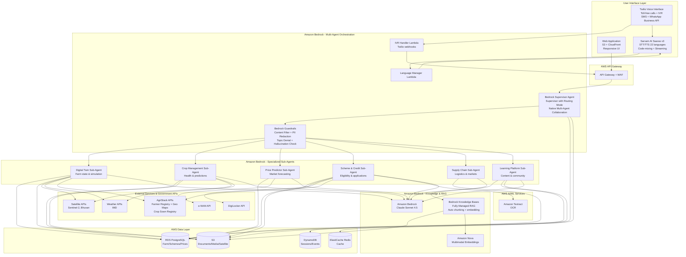
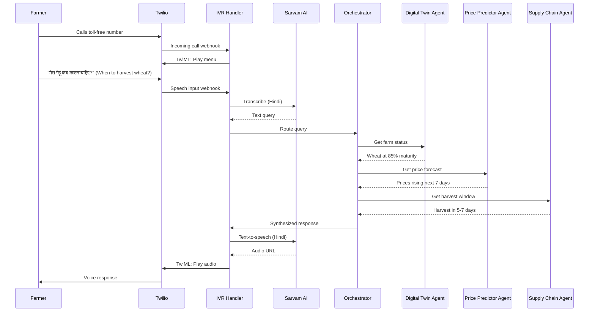
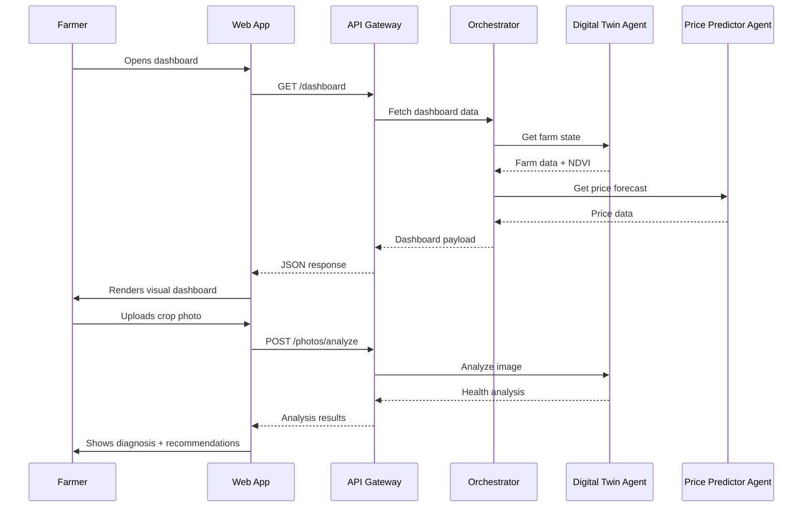
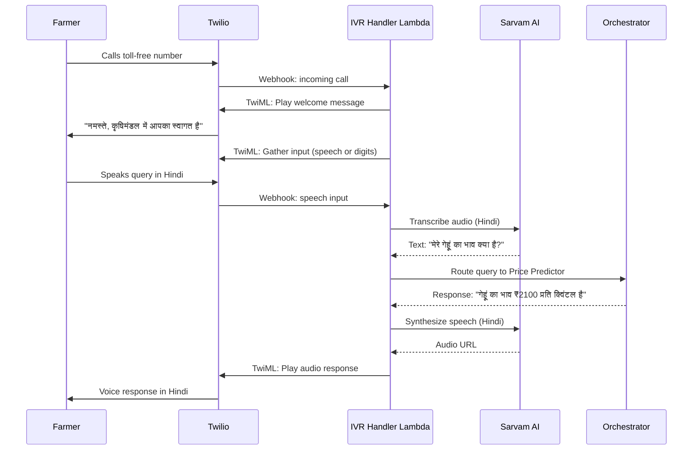
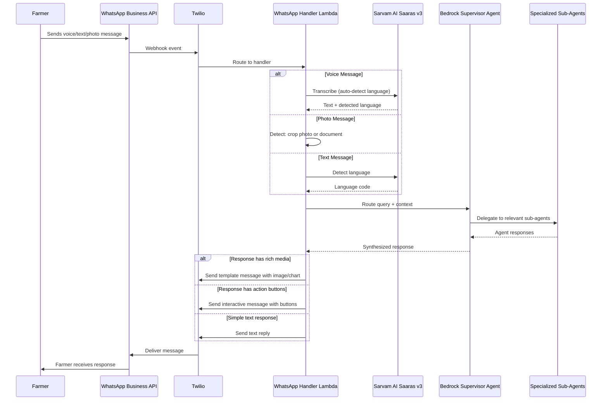
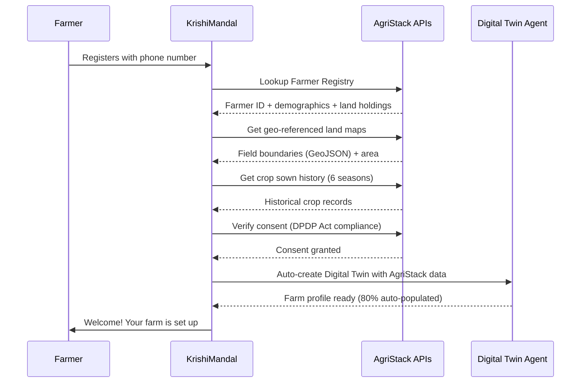

# Design Document: KrishiMandal Platform

## Overview

KrishiMandal is a multi-agent AI system that provides integrated farm intelligence to smallholder farmers in India. The platform architecture consists of six specialized Amazon Bedrock Agents coordinated by a Supervisor Agent using Amazon Bedrock's native Multi-Agent Collaboration (GA March 2025), enabling emergent intelligence through agent collaboration with Supervisor-with-Routing mode for latency-optimized dispatch. Built entirely on AWS services with Sarvam AI for comprehensive multilingual support across all 22 scheduled Indian languages, the platform delivers voice-first interaction optimized for farmers with varying literacy levels and device capabilities. The platform integrates with India's Digital Agriculture Mission (AgriStack) for Farmer ID linkage and geo-referenced land records, and employs Amazon Bedrock Guardrails for responsible AI governance.

### Core Design Principles

1. **Agent Autonomy**: Each module operates as an independent agent with specialized domain knowledge
2. **Dual-Channel Access**: Voice-first via Twilio for accessibility + Web application for rich visual features
3. **Voice-First with Twilio & Sarvam AI**: Toll-free phone calls with IVR navigation in all 22 scheduled Indian languages via Sarvam AI Saaras v3 with code-mixing support, speaker diarization, and streaming STT/TTS
4. **Web-First for Visual Intelligence**: Responsive web app with satellite imagery, price graphs, farm maps, and video content
5. **Offline-First**: Core functionality available without internet, with intelligent synchronization
6. **Privacy by Design**: Farmer data sovereignty with explicit consent and anonymized aggregation
7. **Incremental Value**: Each module provides standalone value while contributing to integrated intelligence
8. **Scalable AWS Architecture**: Serverless design to scale from pilot (10,000 farmers) to national deployment (millions)
9. **Hackathon-Ready**: Design choices favor rapid development with mock data fallbacks for external dependencies

## Architecture

### AWS Infrastructure Overview

The KrishiMandal platform is built entirely on AWS services to ensure scalability, reliability, and rapid deployment for the hackathon MVP.

**Core AWS Services Used**:
- **Compute**: AWS Lambda (serverless agents), AWS Fargate (optional for long-running processes)
- **API**: Amazon API Gateway with AWS WAF
- **AI/ML**: Amazon Bedrock (Claude Sonnet 4.5 - latest 2025 model with hybrid reasoning), Amazon Nova Multimodal Embeddings (unified embeddings for text/images/video/audio), Amazon Textract (OCR)
- **Multi-Agent Orchestration**: Amazon Bedrock Agents with native Multi-Agent Collaboration (Supervisor with Routing mode) — GA March 2025
- **RAG**: Amazon Bedrock Knowledge Bases (fully managed RAG with automatic chunking, embedding, and S3 data source integration)
- **Responsible AI**: Amazon Bedrock Guardrails (content filtering, PII redaction, topic denial, hallucination detection)
- **Voice**: Twilio (voice calls, IVR, SMS, WhatsApp Business API), Sarvam AI (Saaras v3 for STT and TTS in all 22 scheduled Indian languages with code-mixing and speaker diarization)
- **Web**: Amazon S3 + CloudFront (static web app hosting), Amazon Cognito (authentication)
- **Storage**: Amazon S3 (documents, audio, static files, satellite imagery), Amazon RDS PostgreSQL (structured data)
- **Database**: Amazon DynamoDB (sessions, events), Amazon ElastiCache Redis (caching)
- **Authentication**: Amazon Cognito
- **Monitoring**: Amazon CloudWatch, AWS X-Ray
- **Deployment**: AWS SAM or AWS CDK, AWS CloudFormation
- **CDN**: Amazon CloudFront
- **Secrets**: AWS Secrets Manager
- **Messaging**: Amazon EventBridge for event-driven orchestration
- **Government Integration**: AgriStack APIs (Farmer Registry, Geo-referenced Maps, Crop Sown Registry) under India's Digital Agriculture Mission (2024)

**Deployment Strategy for Hackathon**:
- Use AWS SAM (Serverless Application Model) for rapid Lambda deployment
- Infrastructure as Code with CloudFormation templates
- Single AWS region deployment (ap-south-1 Mumbai for India)
- Automated deployment via GitHub Actions + AWS SAM CLI

### System Architecture (AWS-Based)



### Multi-Agent Communication Flow

**Voice Channel (Twilio + Sarvam AI)**:


**Web Channel**:


### Event-Driven Orchestration

**Event Types**:
- `FARM_CREATED`: New farm profile registered (from voice or web)
- `HARVEST_PREDICTED`: Harvest window forecasted (triggers supply chain planning)
- `PEST_ALERT`: Pest outbreak detected (triggers learning content recommendation)
- `PRICE_THRESHOLD`: Price crosses farmer's target (triggers sell notification via voice + web)
- `SCHEME_DEADLINE`: Application deadline approaching (triggers proactive alert)
- `DOCUMENT_VERIFIED`: Document validation complete (triggers application submission)
- `HEALTH_SCORE_LOW`: Crop health below 70 (triggers alert and recommendations)
- `PHOTO_UPLOADED`: Farmer uploads crop photo via web (triggers analysis)
- `VOICE_CALL_COMPLETED`: Call session ends (triggers data sync)

**EventBridge Rules**:
```json
{
  "source": ["krishimandal.digital-twin"],
  "detail-type": ["HARVEST_PREDICTED"],
  "detail": {
    "days_until_harvest": [{"numeric": ["<=", 14]}]
  }
}
```
Triggers: Supply Chain Agent Lambda + Price Predictor Agent Lambda + Notification to both voice and web channels

**Cross-Channel Data Synchronization**:
```python
class DataSyncManager:
    """Ensures data consistency between voice and web interfaces"""
    
    def sync_farm_update(farm_id: str, source: str, updates: Dict) -> None:
        """
        Sync farm updates across channels
        source: 'voice' or 'web'
        """
        # Update database
        db.update_farm(farm_id, updates)
        
        # Invalidate cache
        redis.delete(f"farm:{farm_id}")
        
        # Publish event for real-time updates
        eventbridge.put_events(
            Entries=[{
                'Source': 'krishimandal.sync',
                'DetailType': 'FARM_UPDATED',
                'Detail': json.dumps({
                    'farm_id': farm_id,
                    'source': source,
                    'updates': updates,
                    'timestamp': datetime.now().isoformat()
                })
            }]
        )
        
        # Notify web clients via WebSocket
        if source == 'voice':
            websocket_manager.broadcast(farm_id, {
                'type': 'farm_update',
                'data': updates
            })
```


## Components and Interfaces

### 0. Twilio Voice Interface & IVR System

**Responsibility**: Provide toll-free phone access with IVR navigation, integrate with Sarvam AI for multilingual voice processing.

**AWS Configuration**:
- **Runtime**: Python 3.11
- **Memory**: 512 MB
- **Timeout**: 30 seconds
- **Trigger**: Twilio webhook (HTTP POST)
- **Environment Variables**: TWILIO_ACCOUNT_SID, TWILIO_AUTH_TOKEN, SARVAM_API_KEY

**Twilio Integration**:
```python
class TwilioVoiceHandler:
    def handle_incoming_call(request: TwilioRequest) -> TwiMLResponse
    def handle_gather_input(digits: str, speech: str) -> TwiMLResponse
    def handle_recording(recording_url: str) -> TwiMLResponse
    def send_sms(to: str, message: str, language: str) -> bool
    def send_whatsapp(to: str, message: str, language: str) -> bool
```

**IVR Menu Structure**:
```python
class IVRMenu:
    MAIN_MENU = {
        "1": "farm_status",      # "अपने खेत की स्थिति जानें"
        "2": "market_prices",    # "मंडी भाव जानें"
        "3": "schemes",          # "सरकारी योजनाएं"
        "4": "crop_advice",      # "फसल सलाह"
        "5": "learning",         # "सीखें"
        "9": "speak_to_expert"   # "विशेषज्ञ से बात करें"
    }
```

**Voice Processing Flow**:


**TwiML Response Generation**:
```python
def generate_main_menu_twiml(language: str) -> str:
    """Generate IVR menu in farmer's language"""
    menu_text = get_menu_text(language)
    
    twiml = f"""
    <Response>
        <Gather input="dtmf speech" 
                language="{get_twilio_language_code(language)}"
                speechTimeout="3" 
                timeout="10"
                action="/ivr/handle-input">
            <Say language="{get_twilio_language_code(language)}">
                {menu_text}
            </Say>
        </Gather>
        <Redirect>/ivr/main-menu</Redirect>
    </Response>
    """
    return twiml

def handle_voice_query(speech_text: str, language: str, farmer_id: str) -> TwiMLResponse:
    """Process voice query and generate TwiML response"""
    # Route to orchestrator
    response = orchestrator.route_query(speech_text, farmer_id)
    
    # Synthesize speech using Sarvam AI
    audio_url = sarvam_ai.text_to_speech(response, language)
    
    # Generate TwiML
    twiml = f"""
    <Response>
        <Play>{audio_url}</Play>
        <Gather input="dtmf speech" action="/ivr/handle-input">
            <Say>Press 1 to hear again, 2 for main menu, or speak your next question</Say>
        </Gather>
    </Response>
    """
    return twiml
```

**Sarvam AI Integration (Saaras v3 — Latest 2024/2025 Models)**:

Sarvam AI provides India-first speech and text AI with capabilities significantly superior to generic multilingual models for Indian languages.

**Key Capabilities**:
- **Saaras v3 STT**: 22 Indian languages + English, automatic language detection, code-mixing support (farmers often switch between Hindi + regional language mid-sentence), multi-speaker handling, speaker diarization, telephony-optimized audio processing
- **Sarvam TTS**: Natural regional voices with configurable pitch, pace, and loudness
- **Sarvam Translate**: Formal translation for 22 scheduled Indian languages, numeral format control (international vs native numerals)
- **Mayura**: Colloquial translation model for 10+ Indian languages (better for farmer conversational tone)
- **Streaming API**: REST, Batch, and Streaming APIs for different latency requirements

```python
class SarvamAIClient:
    def __init__(self, api_key: str):
        self.api_key = api_key
        self.base_url = "https://api.sarvam.ai/v1"
    
    def speech_to_text(self, audio_url: str, language: str = "auto") -> dict:
        """Transcribe audio using Sarvam AI Saaras v3
        
        Features:
        - 22 Indian languages + English
        - Automatic language detection (no separate Comprehend call needed)
        - Code-mixing support (e.g., Hindi + Marathi mid-sentence)
        - Speaker diarization for multi-speaker calls
        - Telephony audio optimization
        """
        response = requests.post(
            f"{self.base_url}/speech-to-text",
            headers={"Authorization": f"Bearer {self.api_key}"},
            json={
                "audio_url": audio_url,
                "language_code": language,  # "auto" for auto-detection, or hi-IN, mr-IN, etc.
                "model": "saaras:v3",
                "with_diarization": True,  # Speaker identification
                "output_mode": "verbatim"  # or "transliteration"
            }
        )
        result = response.json()
        return {
            "transcript": result["transcript"],
            "detected_language": result["language_code"],  # Auto-detected language
            "speakers": result.get("speakers", []),
            "confidence": result.get("confidence", 0.0)
        }
    
    def speech_to_text_streaming(self, audio_stream, language: str = "auto"):
        """Real-time streaming STT for low-latency voice interactions"""
        ws = websocket.create_connection(
            f"wss://api.sarvam.ai/v1/speech-to-text/stream",
            header={"Authorization": f"Bearer {self.api_key}"}
        )
        ws.send(json.dumps({"language_code": language, "model": "saaras:v3"}))
        for chunk in audio_stream:
            ws.send(chunk, opcode=websocket.ABNF.OPCODE_BINARY)
            result = json.loads(ws.recv())
            yield result["partial_transcript"]
        ws.close()
    
    def text_to_speech(self, text: str, language: str) -> str:
        """Synthesize speech using Sarvam AI TTS"""
        response = requests.post(
            f"{self.base_url}/text-to-speech",
            headers={"Authorization": f"Bearer {self.api_key}"},
            json={
                "text": text,
                "language_code": language,
                "speaker": "meera",  # Female voice
                "pitch": 0,
                "pace": 1.0,
                "loudness": 1.5
            }
        )
        return response.json()["audio_url"]
    
    def translate(self, text: str, source_lang: str, target_lang: str, 
                  style: str = "colloquial") -> str:
        """Translate text between Indian languages
        
        style: 'formal' uses Sarvam Translate (22 languages)
               'colloquial' uses Mayura (10 languages, better for farmer tone)
        """
        model = "sarvam-translate" if style == "formal" else "mayura:v1"
        response = requests.post(
            f"{self.base_url}/translate",
            headers={"Authorization": f"Bearer {self.api_key}"},
            json={
                "input": text,
                "source_language_code": source_lang,
                "target_language_code": target_lang,
                "model": model,
                "numeral_format": "native"  # Use native numerals (e.g., देवनागरी for Hindi)
            }
        )
        return response.json()["translated_text"]
```

**WhatsApp Business API — First-Class Channel Architecture**:

WhatsApp is the dominant messaging platform in rural India (~500M+ users). KrishiMandal treats WhatsApp as a first-class channel, not a secondary integration.



```python
class WhatsAppBusinessHandler:
    """First-class WhatsApp Business API integration via Twilio"""
    
    def __init__(self, twilio_client, sarvam_client, supervisor_agent):
        self.twilio = twilio_client
        self.sarvam = sarvam_client
        self.supervisor = supervisor_agent
        self.whatsapp_number = 'whatsapp:+919XXXXXXXXX'  # Indian WhatsApp Business number
    
    def handle_incoming(self, from_number: str, message_body: str, 
                        media_url: Optional[str], media_type: Optional[str]) -> None:
        """Handle incoming WhatsApp message with full media support"""
        farmer_id = self._resolve_farmer(from_number)
        
        # Voice message -> transcribe with Saaras v3
        if media_type and media_type.startswith('audio/'):
            result = self.sarvam.speech_to_text(media_url, language="auto")
            query = result["transcript"]
            language = result["detected_language"]
        
        # Photo message -> route to crop analysis or document OCR
        elif media_type and media_type.startswith('image/'):
            query = message_body or "analyze this image"
            language = self._get_farmer_language(farmer_id)
            # Attach image URL for agent processing
            query = f"[IMAGE:{media_url}] {query}"
        
        # Text message
        else:
            result = self.sarvam.speech_to_text_detect_language(message_body)
            query = message_body
            language = result.get("detected_language", "hi-IN")
        
        # Route through Bedrock Supervisor Agent
        response = self.supervisor.invoke(query, farmer_id, language)
        
        # Send response with rich media support
        self._send_response(from_number, response, language)
    
    def _send_response(self, to: str, response: AgentResponse, language: str) -> None:
        """Send rich WhatsApp response with media, buttons, and templates"""
        
        # Price chart response -> send image
        if response.has_chart:
            self.twilio.messages.create(
                from_=self.whatsapp_number,
                to=f'whatsapp:{to}',
                body=response.text,
                media_url=[response.chart_url]  # Price graph from S3
            )
        
        # Scheme eligibility -> send interactive buttons
        elif response.has_actions:
            self._send_interactive_message(to, response)
        
        # Simple text response
        else:
            self.twilio.messages.create(
                from_=self.whatsapp_number,
                to=f'whatsapp:{to}',
                body=response.text
            )
    
    def send_proactive_alert(self, farmer_id: str, alert_type: str, data: Dict) -> None:
        """Send proactive WhatsApp template messages for alerts"""
        farmer = db.get_farmer(farmer_id)
        language = farmer.preferred_language
        
        templates = {
            'price_alert': 'krishimandal_price_alert',      # "₹{price}/quintal for {crop} at {mandi}"
            'pest_warning': 'krishimandal_pest_warning',    # "{pest} risk detected for {crop}"
            'scheme_deadline': 'krishimandal_scheme_alert',  # "{scheme} deadline in {days} days"
            'harvest_ready': 'krishimandal_harvest_ready',   # "{crop} ready for harvest"
            'weather_alert': 'krishimandal_weather_alert',   # "Heavy rain expected in {hours}h"
        }
        
        template_name = templates.get(alert_type)
        if template_name:
            self.twilio.messages.create(
                from_=self.whatsapp_number,
                to=f'whatsapp:{farmer.phone}',
                content_sid=template_name,
                content_variables=json.dumps(data)
            )
    
    def _send_interactive_message(self, to: str, response: AgentResponse) -> None:
        """Send WhatsApp interactive message with action buttons"""
        buttons = []
        for action in response.actions[:3]:  # WhatsApp allows max 3 buttons
            buttons.append({
                "type": "reply",
                "reply": {"id": action.id, "title": action.label}
            })
        
        self.twilio.messages.create(
            from_=self.whatsapp_number,
            to=f'whatsapp:{to}',
            body=response.text,
            persistent_action=buttons
        )
```

**WhatsApp Supported Message Types**:
- **Text**: Plain responses, scheme details, price summaries
- **Images**: Price charts, NDVI maps, crop disease diagnosis images
- **Documents**: Pre-filled scheme application forms (PDF)
- **Interactive Buttons**: Quick actions (Apply for scheme, Check price, Get advice)
- **Template Messages**: Pre-approved proactive alerts (mandatory for outbound messages after 24h window)
- **Voice Messages**: Farmers can send voice queries; response returned as text + optional audio
- **Location**: Farmer can share location for nearest mandi/storage facility lookup

### 0.1 Web Application Interface

**Responsibility**: Provide responsive web UI with visual dashboards, satellite imagery, price graphs, and rich media content.

**Technology Stack**:
- **Frontend**: React 18 with TypeScript
- **UI Framework**: Tailwind CSS + shadcn/ui components
- **State Management**: React Query + Zustand
- **Maps**: Mapbox GL JS for satellite imagery and farm boundaries
- **Charts**: Recharts for price graphs and analytics
- **Hosting**: Amazon S3 + CloudFront CDN
- **Authentication**: Amazon Cognito (OAuth 2.0)

**Web App Architecture**:
```
web-app/
├── src/
│   ├── components/
│   │   ├── Dashboard.tsx          # Main dashboard with farm overview
│   │   ├── FarmMap.tsx            # Satellite imagery + field boundaries
│   │   ├── PriceChart.tsx         # Market price graphs
│   │   ├── CropHealthCard.tsx     # NDVI visualization
│   │   ├── SchemesList.tsx        # Government schemes
│   │   ├── LearningCenter.tsx     # Video content + community
│   │   └── VoiceInput.tsx         # Web-based voice input
│   ├── pages/
│   │   ├── Home.tsx
│   │   ├── FarmProfile.tsx
│   │   ├── MarketPrices.tsx
│   │   ├── Schemes.tsx
│   │   ├── CropManagement.tsx
│   │   └── Learning.tsx
│   ├── services/
│   │   ├── api.ts                 # API Gateway client
│   │   ├── auth.ts                # Cognito authentication
│   │   └── offline.ts             # Service worker for offline mode
│   └── i18n/
│       └── translations/          # 10+ language translations
```

**Key Features**:

1. **Visual Dashboard**:
```typescript
interface DashboardData {
  farmHealth: {
    score: number;
    ndviMap: string;  // S3 URL to NDVI heatmap
    alerts: Alert[];
  };
  marketPrices: {
    currentPrice: number;
    forecast: PriceForecast;
    chartData: PricePoint[];
  };
  harvestPlan: {
    predictedDate: Date;
    expectedYield: number;
    recommendations: string[];
  };
  schemes: SchemeMatch[];
}

const Dashboard: React.FC = () => {
  const { data } = useQuery('dashboard', fetchDashboardData);
  
  return (
    <div className="grid grid-cols-1 md:grid-cols-2 lg:grid-cols-3 gap-4">
      <FarmHealthCard health={data.farmHealth} />
      <PriceChart prices={data.marketPrices} />
      <HarvestPlanCard plan={data.harvestPlan} />
      <SchemesList schemes={data.schemes} />
    </div>
  );
};
```

2. **Satellite Imagery Viewer**:
```typescript
const FarmMap: React.FC<{ farmId: string }> = ({ farmId }) => {
  const { data: farmData } = useQuery(['farm', farmId], fetchFarmData);
  
  return (
    <Map
      mapboxAccessToken={MAPBOX_TOKEN}
      initialViewState={{
        longitude: farmData.location.lng,
        latitude: farmData.location.lat,
        zoom: 15
      }}
      mapStyle="mapbox://styles/mapbox/satellite-v9"
    >
      <Source type="geojson" data={farmData.fieldBoundaries}>
        <Layer type="fill" paint={{ 'fill-color': '#088', 'fill-opacity': 0.3 }} />
      </Source>
      
      <Source type="raster" data={farmData.ndviLayer}>
        <Layer type="raster" paint={{ 'raster-opacity': 0.7 }} />
      </Source>
    </Map>
  );
};
```

3. **Multilingual Support**:
```typescript
import i18n from 'i18next';
import { initReactI18next } from 'react-i18next';

i18n
  .use(initReactI18next)
  .init({
    resources: {
      hi: { translation: hindiTranslations },
      mr: { translation: marathiTranslations },
      kn: { translation: kannadaTranslations },
      // ... 10+ languages
    },
    lng: 'hi',  // Default to Hindi
    fallbackLng: 'en',
    interpolation: { escapeValue: false }
  });
```

4. **Offline Mode**:
```typescript
// Service Worker for offline caching
self.addEventListener('install', (event) => {
  event.waitUntil(
    caches.open('krishimandal-v1').then((cache) => {
      return cache.addAll([
        '/',
        '/dashboard',
        '/static/js/main.js',
        '/static/css/main.css',
        // Cache critical assets
      ]);
    })
  );
});

// Offline data sync
const useOfflineSync = () => {
  const syncQueue = useLocalStorage('sync-queue', []);
  
  useEffect(() => {
    if (navigator.onLine && syncQueue.length > 0) {
      syncQueue.forEach(async (action) => {
        await api.post(action.endpoint, action.data);
      });
      setSyncQueue([]);
    }
  }, [navigator.onLine]);
};
```

5. **Photo Upload**:
```typescript
const CropPhotoUpload: React.FC = () => {
  const [uploading, setUploading] = useState(false);
  
  const handleUpload = async (file: File) => {
    setUploading(true);
    
    // Get presigned URL from backend
    const { uploadUrl, photoId } = await api.post('/photos/presigned-url', {
      filename: file.name,
      contentType: file.type
    });
    
    // Upload to S3
    await fetch(uploadUrl, {
      method: 'PUT',
      body: file,
      headers: { 'Content-Type': file.type }
    });
    
    // Trigger analysis
    const analysis = await api.post('/photos/analyze', { photoId });
    
    setUploading(false);
    return analysis;
  };
  
  return (
    <Dropzone onDrop={handleUpload}>
      {uploading ? <Spinner /> : <UploadIcon />}
    </Dropzone>
  );
};
```

6. **Real-time Notifications**:
```typescript
const useNotifications = () => {
  const [notifications, setNotifications] = useState<Notification[]>([]);
  
  useEffect(() => {
    // WebSocket connection for real-time updates
    const ws = new WebSocket('wss://api.krishimandal.com/notifications');
    
    ws.onmessage = (event) => {
      const notification = JSON.parse(event.data);
      setNotifications(prev => [notification, ...prev]);
      
      // Show browser notification
      if (Notification.permission === 'granted') {
        new Notification(notification.title, {
          body: notification.message,
          icon: '/logo.png'
        });
      }
    };
    
    return () => ws.close();
  }, []);
  
  return notifications;
};
```

**Data Synchronization**:
```typescript
// Sync data between voice and web interfaces
const useSyncedData = (farmId: string) => {
  const queryClient = useQueryClient();
  
  // Poll for updates every 30 seconds
  useQuery(
    ['farm-updates', farmId],
    () => api.get(`/farms/${farmId}/updates`),
    {
      refetchInterval: 30000,
      onSuccess: (data) => {
        // Invalidate related queries to trigger refetch
        queryClient.invalidateQueries(['farm', farmId]);
        queryClient.invalidateQueries(['dashboard']);
      }
    }
  );
};
```

**Deployment**:
```yaml
# CloudFormation template for web app hosting
Resources:
  WebAppBucket:
    Type: AWS::S3::Bucket
    Properties:
      BucketName: krishimandal-webapp
      WebsiteConfiguration:
        IndexDocument: index.html
        ErrorDocument: index.html
  
  CloudFrontDistribution:
    Type: AWS::CloudFront::Distribution
    Properties:
      DistributionConfig:
        Origins:
          - DomainName: !GetAtt WebAppBucket.DomainName
            Id: S3Origin
            S3OriginConfig:
              OriginAccessIdentity: !Sub 'origin-access-identity/cloudfront/${CloudFrontOAI}'
        DefaultCacheBehavior:
          TargetOriginId: S3Origin
          ViewerProtocolPolicy: redirect-to-https
          CachePolicyId: 658327ea-f89d-4fab-a63d-7e88639e58f6  # CachingOptimized
        Enabled: true
        DefaultRootObject: index.html
        CustomErrorResponses:
          - ErrorCode: 404
            ResponseCode: 200
            ResponsePagePath: /index.html
```

### 1. Central Orchestrator — Amazon Bedrock Multi-Agent Collaboration

**Responsibility**: Coordinate inter-agent communication using Amazon Bedrock's native Multi-Agent Collaboration (GA March 2025), manage event-driven workflows, maintain system state consistency.

**Architecture**: Supervisor with Routing Mode
- **Supervisor Agent**: Central Bedrock Agent that analyzes user input, breaks down complex requests, and delegates to specialized sub-agents
- **Routing Mode**: For simple queries (e.g., "wheat price today"), the supervisor routes directly to the Price Predictor sub-agent, bypassing full orchestration — reducing latency by ~40%
- **Supervisor Mode**: For complex multi-domain queries (e.g., "should I sell my wheat now or store it?"), the supervisor invokes Digital Twin + Price Predictor + Supply Chain sub-agents in parallel, then synthesizes responses

**Bedrock Agent Configuration**:
```python
import boto3

bedrock_agent = boto3.client('bedrock-agent', region_name='ap-south-1')

# Create Supervisor Agent
supervisor = bedrock_agent.create_agent(
    agentName='KrishiMandal-Supervisor',
    foundationModel='anthropic.claude-sonnet-4-5-20250514',
    instruction="""You are KrishiMandal's agricultural intelligence supervisor. 
    You coordinate 6 specialized farming agents to help Indian smallholder farmers.
    Analyze the farmer's query, determine which agents are needed, and synthesize 
    a clear, actionable response in the farmer's language.
    
    For simple single-domain queries, route directly to the relevant agent.
    For complex multi-domain queries, invoke multiple agents in parallel.
    Always consider the farmer's profile, location, and current crop state.""",
    agentCollaboration='SUPERVISOR_ROUTER',  # Supervisor with Routing mode
    guardrailConfiguration={
        'guardrailIdentifier': 'krishimandal-guardrail',
        'guardrailVersion': 'DRAFT'
    }
)

# Register Sub-Agents
sub_agents = [
    {'agentId': 'digital-twin-agent', 'description': 'Farm state, simulation, yield prediction, field boundaries'},
    {'agentId': 'crop-management-agent', 'description': 'Crop health, pest prediction, irrigation, fertilizer'},
    {'agentId': 'price-predictor-agent', 'description': 'Mandi prices, forecasts, sell/store decisions'},
    {'agentId': 'scheme-credit-agent', 'description': 'Government schemes, credit scoring, document OCR'},
    {'agentId': 'supply-chain-agent', 'description': 'Harvest logistics, market selection, transport, storage'},
    {'agentId': 'learning-platform-agent', 'description': 'Educational content, RAG chatbot, community Q&A'},
]

for agent in sub_agents:
    bedrock_agent.associate_sub_agent(
        agentId=supervisor['agentId'],
        subAgentId=agent['agentId'],
        subAgentDescription=agent['description']
    )
```

**Key Functions**:
```python
class KrishiMandalOrchestrator:
    """Wrapper around Bedrock Supervisor Agent with additional business logic"""
    
    def invoke_supervisor(self, query: str, farmer_id: str, language: str) -> AgentResponse:
        """Route query through Bedrock Supervisor with farmer context"""
        farm_profile = self.get_farm_profile(farmer_id)
        session_id = self.get_or_create_session(farmer_id)
        
        response = self.bedrock_runtime.invoke_agent(
            agentId=self.supervisor_agent_id,
            agentAliasId=self.supervisor_alias_id,
            sessionId=session_id,
            inputText=f"[Farmer: {farmer_id}, Language: {language}, "
                      f"Location: {farm_profile.location}, "
                      f"Crops: {farm_profile.current_crops}] {query}"
        )
        return self._parse_response(response)
    
    def publish_event(self, event: Event) -> None:
        """Publish event to EventBridge for async agent triggers"""
        eventbridge.put_events(Entries=[{
            'Source': f'krishimandal.{event.source_agent}',
            'DetailType': event.type,
            'Detail': json.dumps(event.data)
        }])
    
    def get_farm_state(self, farm_id: str) -> FarmState:
        """Get cached farm state from Redis, fallback to RDS"""
        cached = redis.get(f"farm:{farm_id}")
        if cached:
            return FarmState.from_json(cached)
        state = db.get_farm_state(farm_id)
        redis.setex(f"farm:{farm_id}", 3600, state.to_json())
        return state
```

**Implementation**:
- **Amazon Bedrock Multi-Agent Collaboration** for intelligent query routing and response synthesis
- **Supervisor with Routing** mode: Direct routing for simple queries, full orchestration for complex ones
- **Native session management** via Bedrock Agent sessions (replaces custom DynamoDB session management)
- EventBridge for async event streaming between agents
- ElastiCache Redis for distributed caching
- DynamoDB for event log persistence
- Amazon Bedrock Guardrails applied at supervisor level (filters all agent responses)
- Distributed tracing with AWS X-Ray

### 1.1 Amazon Bedrock Guardrails — Responsible AI

**Responsibility**: Ensure all AI responses are safe, accurate, and appropriate for agricultural advisory. Protect farmer PII and prevent harmful recommendations.

**Guardrail Configuration**:
```python
bedrock = boto3.client('bedrock', region_name='ap-south-1')

guardrail = bedrock.create_guardrail(
    name='krishimandal-guardrail',
    description='Agricultural advisory safety guardrails for KrishiMandal',
    
    # Content filtering - block harmful agricultural advice
    contentPolicyConfig={
        'filtersConfig': [
            {'type': 'SEXUAL', 'inputStrength': 'HIGH', 'outputStrength': 'HIGH'},
            {'type': 'VIOLENCE', 'inputStrength': 'HIGH', 'outputStrength': 'HIGH'},
            {'type': 'HATE', 'inputStrength': 'HIGH', 'outputStrength': 'HIGH'},
            {'type': 'MISCONDUCT', 'inputStrength': 'HIGH', 'outputStrength': 'HIGH'},
        ]
    },
    
    # Topic denial - restrict non-agricultural queries
    topicPolicyConfig={
        'topicsConfig': [
            {
                'name': 'non-agricultural-advice',
                'definition': 'Medical, legal, financial investment, or political advice unrelated to farming',
                'type': 'DENY',
                'examples': [
                    'Should I invest in stocks?',
                    'What medicine should I take?',
                    'Which political party should I vote for?'
                ]
            },
            {
                'name': 'harmful-chemical-recommendations',
                'definition': 'Recommendations for banned or restricted pesticides/chemicals',
                'type': 'DENY',
                'examples': [
                    'Use DDT on crops',
                    'Apply endosulfan for pest control',
                    'Use monocrotophos without safety equipment'
                ]
            }
        ]
    },
    
    # PII redaction - protect farmer sensitive data
    sensitiveInformationPolicyConfig={
        'piiEntitiesConfig': [
            {'type': 'AADHAAR_NUMBER', 'action': 'ANONYMIZE'},  # Indian Aadhaar
            {'type': 'PHONE_NUMBER', 'action': 'ANONYMIZE'},
            {'type': 'EMAIL_ADDRESS', 'action': 'ANONYMIZE'},
            {'type': 'CREDIT_DEBIT_CARD_NUMBER', 'action': 'BLOCK'},
            {'type': 'BANK_ACCOUNT_NUMBER', 'action': 'ANONYMIZE'},
        ],
        'regexesConfig': [
            {
                'name': 'aadhaar-pattern',
                'description': 'Indian Aadhaar number pattern',
                'pattern': r'\b\d{4}\s?\d{4}\s?\d{4}\b',
                'action': 'ANONYMIZE'
            },
            {
                'name': 'pan-card-pattern',
                'description': 'Indian PAN card number',
                'pattern': r'\b[A-Z]{5}\d{4}[A-Z]\b',
                'action': 'ANONYMIZE'
            }
        ]
    },
    
    # Contextual grounding - prevent hallucinated prices/schemes
    contextualGroundingPolicyConfig={
        'filtersConfig': [
            {
                'type': 'GROUNDING',
                'threshold': 0.7  # Responses must be 70%+ grounded in provided context
            },
            {
                'type': 'RELEVANCE',
                'threshold': 0.7  # Responses must be 70%+ relevant to the query
            }
        ]
    },
    
    blockedInputMessaging='I can only help with farming-related questions. Please ask about crops, prices, schemes, or farm management.',
    blockedOutputsMessaging='I apologize, I cannot provide this information. Please contact your local KVK (Krishi Vigyan Kendra) for expert advice.'
)
```

**Guardrail Coverage**:
| Category | Protection | Example |
|----------|------------|----------|
| Content Safety | Block harmful content in inputs/outputs | Violent, sexual, hate content |
| Topic Denial | Restrict to agricultural domain | Block medical/legal/political advice |
| PII Redaction | Anonymize farmer sensitive data | Aadhaar, phone, bank details |
| Chemical Safety | Block banned chemical recommendations | DDT, endosulfan, restricted pesticides |
| Hallucination Prevention | Ground responses in retrieved data | Prevent fabricated prices/schemes |
| Contextual Relevance | Ensure responses match queries | Avoid off-topic agricultural advice |

### 1.2 AgriStack Integration — India's Digital Agriculture Mission

**Responsibility**: Integrate with India's Digital Agriculture Mission (DAM, approved Sep 2024, ₹2,817 crore budget) to leverage the AgriStack Digital Public Infrastructure for farmer identity, land records, and crop data.

**AgriStack Components Used**:

1. **Farmer Registry (Farmer ID)**:
   - 10-digit digital Farmer ID linked to demographics, landholdings, and crops
   - 8.48 crore farmers enrolled as of Feb 2026 across 19 states
   - Used for instant farmer onboarding and identity verification
   - Links to Aadhaar, land records, and livestock ownership

2. **Geo-referenced Village Maps**:
   - Geographic information of land records with precise locations
   - Used by Digital Twin Agent for field boundary detection
   - Replaces manual boundary mapping for faster onboarding

3. **Crop Sown Registry**:
   - Digital crop survey data recorded via mobile-based surveys
   - Provides verified historical crop data for Digital Twin
   - Enables regional crop pattern analysis for Price Predictor

**Integration Architecture**:
```python
class AgriStackClient:
    """Integration with India's AgriStack Digital Public Infrastructure"""
    
    def __init__(self, api_key: str):
        self.base_url = "https://api.agristack.gov.in/v1"
        self.api_key = api_key
    
    def lookup_farmer(self, phone_number: str = None, aadhaar_hash: str = None,
                      farmer_id: str = None) -> FarmerRegistryRecord:
        """Look up farmer from AgriStack Farmer Registry
        
        Returns: Farmer ID, demographics, land holdings, enrolled schemes
        """
        params = {}
        if farmer_id:
            params['farmer_id'] = farmer_id
        elif phone_number:
            params['phone'] = phone_number
        elif aadhaar_hash:
            params['aadhaar_hash'] = aadhaar_hash
        
        response = requests.get(
            f"{self.base_url}/farmer-registry/lookup",
            headers={"Authorization": f"Bearer {self.api_key}"},
            params=params
        )
        return FarmerRegistryRecord.from_dict(response.json())
    
    def get_land_records(self, farmer_id: str) -> List[LandRecord]:
        """Get geo-referenced land records from AgriStack
        
        Returns: Field boundaries (GeoJSON), area, soil type, land classification
        """
        response = requests.get(
            f"{self.base_url}/geo-maps/farmer/{farmer_id}",
            headers={"Authorization": f"Bearer {self.api_key}"}
        )
        return [LandRecord.from_dict(r) for r in response.json()["land_records"]]
    
    def get_crop_history(self, farmer_id: str, seasons: int = 6) -> List[CropSownRecord]:
        """Get crop sown history from AgriStack Crop Sown Registry
        
        Returns: Historical crop data from digital crop surveys
        """
        response = requests.get(
            f"{self.base_url}/crop-registry/farmer/{farmer_id}",
            headers={"Authorization": f"Bearer {self.api_key}"},
            params={"seasons": seasons}
        )
        return [CropSownRecord.from_dict(r) for r in response.json()["crop_records"]]
    
    def verify_farmer_consent(self, farmer_id: str, purpose: str) -> ConsentStatus:
        """Check farmer's data sharing consent via AgriStack Consent Manager
        
        Compliant with Digital Personal Data Protection (DPDP) Act, 2023
        """
        response = requests.get(
            f"{self.base_url}/consent/check",
            headers={"Authorization": f"Bearer {self.api_key}"},
            params={"farmer_id": farmer_id, "purpose": purpose}
        )
        return ConsentStatus.from_dict(response.json())
```

**Data Flow with AgriStack**:


**Benefits of AgriStack Integration**:
- **Instant Onboarding**: 80% of farm profile auto-populated from Farmer Registry + Geo Maps
- **Verified Data**: Government-verified land records eliminate manual data entry errors
- **Historical Context**: 6+ seasons of crop history from Crop Sown Registry enriches Digital Twin
- **Scheme Integration**: Direct linkage to enrolled government schemes via Farmer ID
- **DPDP Compliance**: Built-in Consent Manager ensures data privacy compliance
- **Scalability**: 8.48 crore farmers already in the registry — ready for national scale

### 2. Digital Twin Agent (AWS Lambda)

**Responsibility**: Maintain virtual farm replica, simulate scenarios, predict yields and harvest timing.

**AWS Configuration**:
- **Runtime**: Python 3.11
- **Memory**: 2048 MB (for ML inference)
- **Timeout**: 60 seconds
- **Layers**: NumPy, SciPy, scikit-learn
- **Trigger**: API Gateway + EventBridge

**Data Model**:
```python
class FarmProfile:
    farm_id: str
    farmer_id: str
    location: GeoCoordinates
    area_hectares: float
    field_boundaries: List[Polygon]  # GeoJSON
    soil_type: SoilType  # black, red, alluvial, laterite, sandy
    soil_ph: float
    water_sources: List[WaterSource]  # canal, borewell, well, rainfed
    irrigation_type: IrrigationType
    current_crops: List[CropInstance]
    historical_crops: List[CropHistory]
    
class CropInstance:
    crop_type: str
    variety: str
    planting_date: date
    expected_harvest: date
    area_hectares: float
    growth_stage: GrowthStage  # germination, vegetative, flowering, maturity
    health_score: float  # 0-100
    
class FarmState:
    timestamp: datetime
    ndvi_values: List[float]  # From satellite imagery
    soil_moisture: float
    nutrient_levels: Dict[str, float]  # N, P, K, etc.
    weather_conditions: WeatherSnapshot
    pest_pressure: Dict[str, float]
    disease_risk: Dict[str, float]
```

**Key Functions**:
```python
class DigitalTwinAgent:
    def create_farm(voice_input: VoiceData) -> FarmProfile
    def detect_field_boundaries(location: GeoCoordinates) -> List[Polygon]
    def sync_farm_state(farm_id: str) -> FarmState
    def simulate_scenario(farm_id: str, scenario: Scenario) -> SimulationResult
    def predict_harvest(farm_id: str) -> HarvestPrediction
    def predict_yield(farm_id: str) -> YieldPrediction
    def generate_risk_alerts(farm_id: str) -> List[Alert]
```

**Simulation Engine**:
- **Crop growth model**: Physics-informed neural network with GDD (Growing Degree Days) accumulation, phenology stages
- **Water balance**: Rainfall + irrigation - evapotranspiration - runoff - deep percolation
- **Nutrient dynamics**: Uptake rates by growth stage, mineralization, leaching
- **Yield estimation**: Biomass accumulation × harvest index × stress factors

**Field Boundary Detection**:
- Computer vision on Sentinel-2 satellite imagery (10m resolution)
- Edge detection using Canny algorithm
- Polygon extraction with Douglas-Peucker simplification
- Validation against cadastral data where available
- Stored in S3 as GeoJSON

**Scenario Simulation**:
- Monte Carlo methods for weather uncertainty (1000 iterations)
- Crop model ensemble for yield prediction
- Economic analysis with price forecasts from Price Predictor Agent
- Risk quantification (drought, pest, market volatility)

### 3. Crop Management Agent (AWS Lambda)

**Responsibility**: Monitor crop health, predict pests/diseases, recommend inputs, optimize irrigation.

**AWS Configuration**:
- **Runtime**: Python 3.11
- **Memory**: 3008 MB (for computer vision models)
- **Timeout**: 60 seconds
- **Layers**: TensorFlow Lite, OpenCV
- **Trigger**: API Gateway + EventBridge (scheduled for daily health checks)

**Data Model**:
```python
class CropHealth:
    farm_id: str
    timestamp: datetime
    health_score: float  # 0-100
    ndvi_mean: float
    ndvi_std: float
    spatial_map: NDArray  # 2D array of health values
    anomalies: List[Anomaly]
    components: HealthComponents
    
class HealthComponents:
    soil_score: int  # 0-25
    season_score: int  # 0-25
    stage_score: int  # 0-25
    weather_score: int  # 0-25
    
class Anomaly:
    location: GeoCoordinates
    type: str  # pest, disease, water_stress, nutrient_deficiency
    severity: float  # 0-1
    confidence: float  # 0-1
    
class PestAlert:
    pest_type: str
    risk_level: float  # 0-1
    affected_area: Polygon
    forecast_days: int  # 3-7 days advance warning
    recommended_actions: List[str]
    
class InputRecommendation:
    input_type: str  # fertilizer, pesticide, irrigation
    product: str
    quantity: float
    timing: datetime
    application_method: str
    expected_benefit: str
    cost: float
```

**Key Functions**:
```python
class CropManagementAgent:
    def acquire_satellite_imagery(farm_id: str) -> SatelliteImage
    def compute_health_score(farm_id: str) -> CropHealth
    def analyze_crop_photo(image: bytes) -> PhotoAnalysis
    def predict_pest_outbreak(farm_id: str, days_ahead: int) -> List[PestAlert]
    def predict_growth_stage(farm_id: str) -> GrowthStagePrediction
    def detect_stress(farm_id: str) -> List[StressIndicator]
    def model_soil_nutrients(farm_id: str) -> NutrientStatus
    def recommend_fertilizer(farm_id: str) -> InputRecommendation
    def model_soil_moisture(farm_id: str) -> MoistureStatus
    def recommend_irrigation(farm_id: str) -> IrrigationSchedule
```

**ML Models**:
- **Crop health**: CNN on satellite imagery (NDVI, NDRE, NDWI bands) with ResNet-50 backbone, fine-tuned on Indian crops
- **Pest prediction**: LSTM on weather time series + spatial convolutional layers for regional patterns
- **Growth stage**: Phenology model with GDD + computer vision on farmer photos (MobileNetV3 for mobile deployment)
- **Stress detection**: Anomaly detection on NDVI time series using Isolation Forest
- **Nutrient modeling**: Mass balance equations + crop uptake curves calibrated per soil type
- **Irrigation**: Soil water balance model + crop coefficient (Kc) by growth stage

**Satellite Imagery Processing**:
- Sentinel-2 acquisition every 5 days (10m resolution)
- Cloud masking using QA60 band
- Atmospheric correction with Sen2Cor
- NDVI = (NIR - Red) / (NIR + Red)
- NDRE = (NIR - RedEdge) / (NIR + RedEdge)
- NDWI = (Green - NIR) / (Green + NIR)
- Spatial aggregation to farm boundaries using zonal statistics
- Time series analysis for trend detection

**Pest and Disease Prediction**:
- Weather-based risk models (temperature, humidity, rainfall thresholds)
- Historical outbreak data for regional patterns (3+ years)
- Crowdsourced reports for real-time validation
- 3-7 day advance warnings with confidence scores
- Integration with IMD weather forecasts

**Health Score Calculation**:
```python
def calculate_health_score(farm: FarmProfile, weather: WeatherData) -> CropHealth:
    soil_score = evaluate_soil_crop_match(farm.soil_type, farm.current_crop)  # 0-25
    season_score = evaluate_seasonal_suitability(farm.planting_date, farm.location)  # 0-25
    stage_score = evaluate_growth_stage_progress(farm.current_crop, farm.planting_date)  # 0-25
    weather_score = evaluate_weather_conditions(weather, farm.current_crop)  # 0-25
    
    total_score = soil_score + season_score + stage_score + weather_score
    
    return CropHealth(
        health_score=total_score,
        components=HealthComponents(
            soil_score=soil_score,
            season_score=season_score,
            stage_score=stage_score,
            weather_score=weather_score
        )
    )
```

### 4. Mandi Price Predictor Agent (AWS Lambda)

**Responsibility**: Forecast crop prices at multiple time horizons, recommend sell/store decisions.

**AWS Configuration**:
- **Runtime**: Python 3.11
- **Memory**: 2048 MB
- **Timeout**: 30 seconds
- **Layers**: pandas, statsmodels, prophet
- **Trigger**: API Gateway + EventBridge (daily price data ingestion)

**Data Model**:
```python
class PriceForecast:
    crop: str
    mandi: str
    current_price: float
    forecast_7day: float
    forecast_30day: float
    forecast_next_season: float
    confidence_intervals: Dict[str, Tuple[float, float]]  # 95% CI
    factors: List[PriceFactor]
    trend: str  # rising, falling, stable
    
class PriceFactor:
    factor: str  # supply, demand, weather, policy, global_prices
    impact: float  # -1 to 1
    explanation: str
    
class MarketDecision:
    recommendation: str  # sell_now, store_N_weeks, wait
    expected_net_realization: float
    best_mandi: str
    timing: date
    risk_assessment: str
    opportunity_cost: float
    
class NetRealization:
    gross_amount: float
    transport_cost: float
    market_fee: float
    handling_cost: float
    storage_cost: float
    net_amount: float
```

**Key Functions**:
```python
class PricePredictorAgent:
    def ingest_price_data() -> None
    def forecast_short_term(crop: str, mandi: str, days: int) -> PriceForecast
    def forecast_medium_term(crop: str, mandi: str, weeks: int) -> PriceForecast
    def forecast_long_term(crop: str, region: str) -> PriceForecast
    def recommend_decision(farm_id: str, crop: str, quantity: float) -> MarketDecision
    def find_best_mandi(location: GeoCoordinates, crop: str, radius_km: float) -> MandiRanking
    def calculate_net_realization(price: float, costs: CostBreakdown) -> NetRealization
```

**Forecasting Models**:
- **Short-term (1-7 days)**: ARIMA(p,d,q) + exogenous variables (arrivals, weather, festivals)
  - Auto-ARIMA for parameter selection
  - Features: lagged prices, arrivals, weather shocks, festival calendar
  
- **Medium-term (2-8 weeks)**: Prophet with regional harvest calendars, policy events, processing demand
  - Seasonality: yearly, weekly
  - Holidays: festivals, government procurement dates
  - Regressors: regional harvest volumes, MSP announcements
  
- **Long-term (next season)**: Ensemble of LSTM, XGBoost, and econometric models
  - LSTM: 3-layer bidirectional, 128 units, dropout 0.2
  - XGBoost: 100 estimators, max_depth 5
  - Econometric: Supply-demand equilibrium model
  - Ensemble: Weighted average based on historical accuracy

**Data Sources**:
- e-NAM real-time API (1000+ mandis)
- AGMARKNET historical data (10+ years)
- Commodity exchange prices (NCDEX, MCX)
- Crowdsourced farmer reports
- Global commodity indices (FAO, World Bank)
- MSP announcements from government
- Weather data from IMD

**Market Decision Logic**:
```python
def recommend_decision(farm_id: str, crop: str, quantity: float) -> MarketDecision:
    current_price = get_current_price(crop, farm_location)
    forecast_7day = forecast_short_term(crop, 7)
    msp = get_msp(crop)
    historical_avg = get_historical_average(crop, season)
    
    # Calculate opportunity cost
    if forecast_7day > current_price * 1.05:  # 5% price rise expected
        recommendation = f"store_{calculate_optimal_storage_days(forecast)}_weeks"
    elif current_price > historical_avg * 1.1:  # 10% above average
        recommendation = "sell_now"
    elif current_price < msp:
        recommendation = "wait"  # Wait for MSP procurement
    else:
        recommendation = "sell_now"
    
    best_mandi = find_best_mandi(farm_location, crop, radius_km=100)
    net_realization = calculate_net_realization(current_price, quantity, best_mandi)
    
    return MarketDecision(
        recommendation=recommendation,
        expected_net_realization=net_realization.net_amount,
        best_mandi=best_mandi.name,
        opportunity_cost=calculate_opportunity_cost(current_price, forecast_7day)
    )
```

### 5. Scheme & Credit Navigator Agent (AWS Lambda)

**Responsibility**: Match farmers to schemes, process applications, assess creditworthiness.

**AWS Configuration**:
- **Runtime**: Python 3.11
- **Memory**: 1024 MB
- **Timeout**: 30 seconds
- **Trigger**: API Gateway + EventBridge (scheme deadline monitoring)

**Data Model**:
```python
class Scheme:
    scheme_id: str
    name: str
    description: Dict[str, str]  # language -> text
    eligibility_criteria: List[Criterion]
    benefits: BenefitStructure
    application_deadline: date
    required_documents: List[DocumentType]
    portal_url: str
    state: str
    
class Criterion:
    field: str  # land_size, crop_type, location, income
    operator: str  # >, <, ==, in
    value: Any
    
class SchemeMatch:
    scheme_id: str
    scheme_name: str
    eligibility_score: float  # 0-1
    benefits: str
    requirements: List[str]
    deadline: Optional[date]
    application_url: str
    missing_criteria: List[str]
    
class CreditScore:
    farmer_id: str
    score: float  # 0-100
    components: Dict[str, float]
    last_updated: datetime
    
class CreditComponents:
    farm_activity: float  # 30%: Planting consistency, input usage, crop diversity
    crop_health: float  # 25%: Average NDVI, pest/disease incidents, yield trends
    market_engagement: float  # 20%: Selling patterns, price realization, buyer relationships
    peer_reputation: float  # 15%: Community ratings, knowledge sharing, payment history
    scheme_compliance: float  # 10%: Benefit utilization, documentation completeness
```

**Key Functions**:
```python
class SchemeNavigatorAgent:
    def match_schemes(farmer_profile: FarmProfile) -> List[SchemeMatch]
    def quantify_benefits(scheme_id: str, farmer_profile: FarmProfile) -> float
    def extract_document(image: bytes) -> Document
    def verify_document(document: Document) -> VerificationResult
    def submit_application(application: Application) -> SubmissionResult
    
class CreditAgent:
    def compute_credit_score(farmer_id: str) -> CreditScore
    def match_lenders(farmer_id: str, loan_amount: float) -> List[LenderMatch]
    def generate_repayment_plan(loan: Loan, harvest_dates: List[date]) -> RepaymentPlan
```

**Scheme Database**:
- 100+ government schemes (PM-KISAN, PMFBY, PM-KUSUM, Soil Health Card, Kisan Credit Card, etc.)
- Eligibility criteria engine with complex rule evaluation
- Deadline tracking with proactive alerts (30 days advance)
- Benefit quantification per farmer profile
- Stored in RDS PostgreSQL with JSONB for flexible criteria

**Document Processing**:
- OCR using Amazon Textract
- Document type classification (Aadhaar, land records, bank passbook, etc.) using Amazon Comprehend Custom Classification
- Multilingual document explanation using Amazon Bedrock + Sarvam AI translation
- DigiLocker integration for verification
- Aadhaar and land registry API integration
- Stored in S3 with encryption

**Credit Scoring Model**:
```python
def compute_credit_score(farmer_id: str) -> CreditScore:
    farm_activity = calculate_farm_activity_score(farmer_id)  # 0-30
    crop_health = calculate_crop_health_score(farmer_id)  # 0-25
    market_engagement = calculate_market_engagement_score(farmer_id)  # 0-20
    peer_reputation = calculate_peer_reputation_score(farmer_id)  # 0-15
    scheme_compliance = calculate_scheme_compliance_score(farmer_id)  # 0-10
    
    total_score = (farm_activity + crop_health + market_engagement + 
                   peer_reputation + scheme_compliance)
    
    return CreditScore(
        farmer_id=farmer_id,
        score=total_score,
        components={
            'farm_activity': farm_activity,
            'crop_health': crop_health,
            'market_engagement': market_engagement,
            'peer_reputation': peer_reputation,
            'scheme_compliance': scheme_compliance
        },
        last_updated=datetime.now()
    )
```

### 6. Supply Chain Optimization Agent (AWS Lambda)

**Responsibility**: Plan harvest logistics, coordinate collection, grade quality, optimize market selection.

**AWS Configuration**:
- **Runtime**: Python 3.11
- **Memory**: 1024 MB
- **Timeout**: 30 seconds
- **Layers**: OR-Tools for optimization
- **Trigger**: API Gateway + EventBridge (harvest prediction trigger)

**Key Functions**:
```python
class SupplyChainAgent:
    def generate_preharvest_plan(farm_id: str) -> HarvestPlan
    def optimize_collection_routes(farms: List[str], date: date) -> List[CollectionRoute]
    def grade_quality(image: bytes) -> QualityGrade
    def recommend_markets(farm_id: str, quality: QualityGrade) -> List[MarketOption]
    def calculate_storage_duration(crop: str, price_forecast: PriceForecast) -> int
```

**Optimization Algorithms**:
- **Collection routing**: Vehicle Routing Problem (VRP) with time windows and capacity constraints using OR-Tools
  - Objective: Minimize total distance + time
  - Constraints: Vehicle capacity, time windows, driver hours
  - Solver: Clarke-Wright savings algorithm + local search
  
- **Market selection**: Multi-objective optimization (price, distance, reliability, payment terms)
  - Pareto frontier calculation
  - Weighted scoring based on farmer preferences
  
- **Storage decision**: Dynamic programming considering price forecast, storage cost, quality degradation
  - State: (time, quality, price)
  - Action: sell or store
  - Reward: net realization

**Quality Grading**:
- Computer vision on crop photos (MobileNetV3 for mobile deployment)
- Multi-class classification (A/B/C grades)
- Defect detection (spots, discoloration, size uniformity)
- Moisture content estimation from visual cues
- Confidence scoring

**Logistics Coordination**:
- Multi-farmer collection route optimization
- Real-time vehicle tracking with GPS (integration with logistics partners)
- Cold chain monitoring for perishables (IoT temperature sensors)
- Buyer matching based on quality and payment terms

### 7. Farmer Learning Platform Agent (AWS Lambda)

**Responsibility**: Deliver personalized learning content, answer questions via RAG chatbot, facilitate peer learning.

**AWS Configuration**:
- **Runtime**: Python 3.11
- **Memory**: 2048 MB
- **Timeout**: 30 seconds
- **Trigger**: API Gateway

**Key Functions**:
```python
class LearningPlatformAgent:
    def process_voice_query(audio: bytes, language: str) -> ChatMessage
    def recommend_content(farmer_id: str) -> List[LearningContent]
    def trigger_just_in_time_learning(event: Event, farmer_id: str) -> List[LearningContent]
    def post_question(farmer_id: str, question: str) -> CommunityPost
    def answer_question(question_id: str, answer: str, farmer_id: str) -> CommunityAnswer
```

**RAG-based Chatbot Architecture — Amazon Bedrock Knowledge Bases (Fully Managed RAG)**:

KrishiMandal uses **Amazon Bedrock Knowledge Bases** for fully managed RAG, eliminating the need for custom OpenSearch setup, manual chunking, and embedding pipeline management.

**Knowledge Base Configuration**:
```python
bedrock_agent = boto3.client('bedrock-agent', region_name='ap-south-1')

# Create Knowledge Base with S3 data source
knowledge_base = bedrock_agent.create_knowledge_base(
    name='krishimandal-agricultural-kb',
    description='Agricultural knowledge base for Indian farming practices, schemes, and crop management',
    roleArn='arn:aws:iam::role/KrishiMandalKBRole',
    knowledgeBaseConfiguration={
        'type': 'VECTOR',
        'vectorKnowledgeBaseConfiguration': {
            'embeddingModelArn': 'arn:aws:bedrock:ap-south-1::foundation-model/amazon.nova-embed-multimodal-v1:0',
            'embeddingModelConfiguration': {
                'bedrockEmbeddingModelConfiguration': {
                    'dimensions': 1024  # Balanced performance/cost
                }
            }
        }
    },
    storageConfiguration={
        'type': 'OPENSEARCH_SERVERLESS',  # Managed by Bedrock, no manual setup
        'opensearchServerlessConfiguration': {
            'collectionArn': 'auto-created',
            'fieldMapping': {
                'vectorField': 'embedding',
                'textField': 'text',
                'metadataField': 'metadata'
            }
        }
    }
)

# Add S3 data source (auto-sync with chunking)
data_source = bedrock_agent.create_data_source(
    knowledgeBaseId=knowledge_base['knowledgeBaseId'],
    name='agricultural-content',
    dataSourceConfiguration={
        'type': 'S3',
        's3Configuration': {
            'bucketArn': 'arn:aws:s3:::krishimandal-knowledge-content'
        }
    },
    vectorIngestionConfiguration={
        'chunkingConfiguration': {
            'chunkingStrategy': 'SEMANTIC',  # Intelligent semantic chunking
            'semanticChunkingConfiguration': {
                'maxTokens': 512,
                'bufferSize': 0,
                'breakpointPercentileThreshold': 95
            }
        }
    }
)
```

**S3 Knowledge Content Structure**:
```
krishimandal-knowledge-content/
├── government-schemes/          # PM-KISAN, PMFBY, PM-KUSUM docs
├── crop-management/             # Pest control, irrigation, fertilizer guides
├── market-practices/            # Mandi procedures, grading standards
├── icar-bulletins/              # Research summaries from ICAR institutes
├── state-agriculture/           # State-specific extension materials
├── organic-farming/             # Organic certification, practices
├── water-management/            # Drip irrigation, rainwater harvesting
└── farmer-success-stories/      # Case studies in regional languages
```

**Key Advantages Over Custom RAG**:
- **Automatic chunking**: Semantic chunking by Bedrock (no custom code needed)
- **Auto-sync**: Changes to S3 content automatically re-indexed
- **Managed vector store**: No OpenSearch cluster to manage
- **Citation support**: Responses include source citations for traceability
- **Bedrock Guardrails integration**: Content safety applied automatically

**Embeddings**: Amazon Nova Multimodal Embeddings (unified model supporting text, documents, images, video, and audio)
  - Context length: up to 8,192 tokens
  - Supports 200+ languages (covers all 22 scheduled Indian languages)
  - Output dimensions: 1,024 (default for Knowledge Bases)
  - Enables cross-modal retrieval (e.g., search videos using text query, find similar crop photos)

**LLM**: Amazon Bedrock Claude Sonnet 4.5 (latest 2025 model) with hybrid reasoning
  - Two modes: instant responses + extended thinking for complex queries
  - Superior coding and reasoning capabilities
  - 20% performance boost over Claude 3.5
  - Larger context window for comprehensive responses
  - Bedrock Guardrails applied to both input and output

**RAG Query Flow (Bedrock Knowledge Bases)**:
1. Farmer query (voice via Sarvam AI Saaras v3, text via web/WhatsApp, or image upload)
2. Bedrock Knowledge Base automatically handles embedding + semantic search
3. Retrieved chunks injected into Claude Sonnet 4.5 prompt with farmer's Farm_Profile context
4. Bedrock Guardrails check input (PII redaction, topic filtering)
5. Generate response using hybrid reasoning (instant or extended thinking based on complexity)
6. Bedrock Guardrails check output (hallucination grounding, content safety)
7. Confidence scoring — if below 0.7, escalate to human expert
8. Convert response to speech via Sarvam AI Saaras v3 (if voice/WhatsApp channel)
9. Return with source citations for farmer trust

**Cross-Modal Capabilities**:
- Farmers can upload crop photo and get relevant video tutorials
- Search text content using voice queries in any of 22 languages
- Find similar satellite imagery patterns
- Unified multimodal embeddings reduce complexity and cost

**Voice Pipeline with Sarvam AI (Saaras v3)**:
- **ASR**: Sarvam AI Saaras v3 speech-to-text for all 22 scheduled Indian languages + English, with code-mixing and speaker diarization
- **TTS**: Sarvam AI text-to-speech with natural regional voices (customizable pitch/pace/loudness)
- **Language detection**: Built-in automatic language detection in Saaras v3 (no separate service needed)
- **Code-mixing**: Handles mid-sentence language switches (e.g., Hindi↔Marathi) common among Indian farmers
- **Streaming API**: REST, Batch, and Streaming APIs for different latency requirements
- **Telephony optimization**: Saaras v3 handles background noise and poor phone connections

**Content Library**:
- Videos, audio, text in all 22 scheduled Indian languages (Hindi, Marathi, Kannada, Telugu, Tamil, Gujarati, Punjabi, Bengali, Odia, Malayalam, Assamese, Bodo, Dogri, Kashmiri, Konkani, Maithili, Manipuri, Nepali, Santali, Sanskrit, Sindhi, Urdu)
- Government bulletins from Ministry of Agriculture
- Extension materials from state agricultural universities
- Research summaries from ICAR institutes
- Farmer success stories and case studies
- Structured learning paths by topic (organic farming, water management, pest control, soil health)
- Stored in S3 with CloudFront CDN for fast delivery

**Community Features**:
- Q&A forum with peer answers (stored in RDS)
- Reputation system for helpful farmers (gamification)
- Live expert sessions with agricultural scientists (integration with video conferencing)
- Peer connections based on crop and location similarity (recommendation engine)

